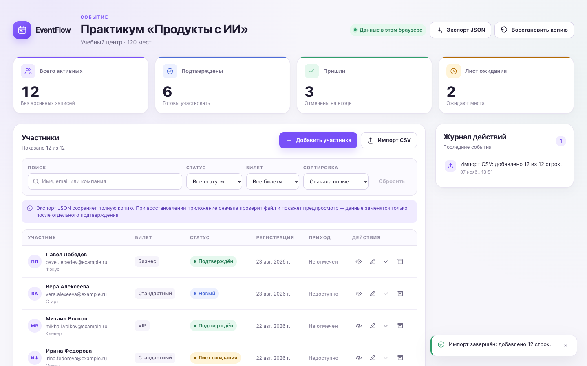
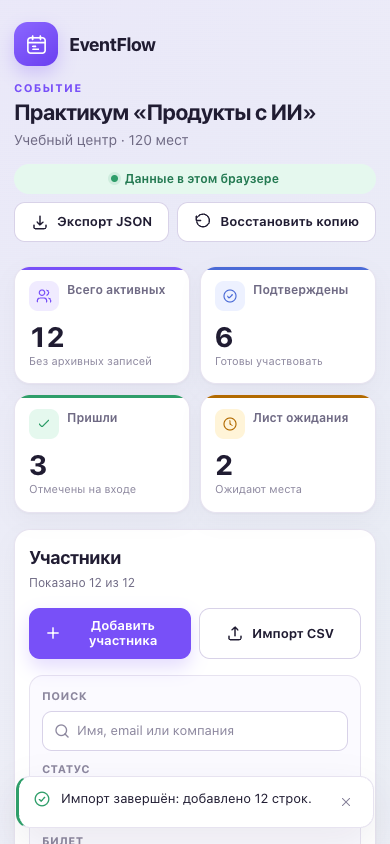
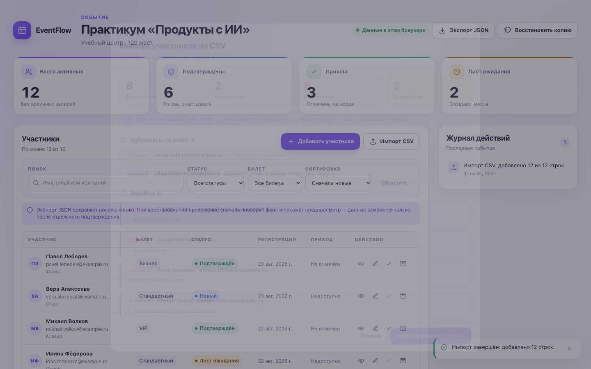
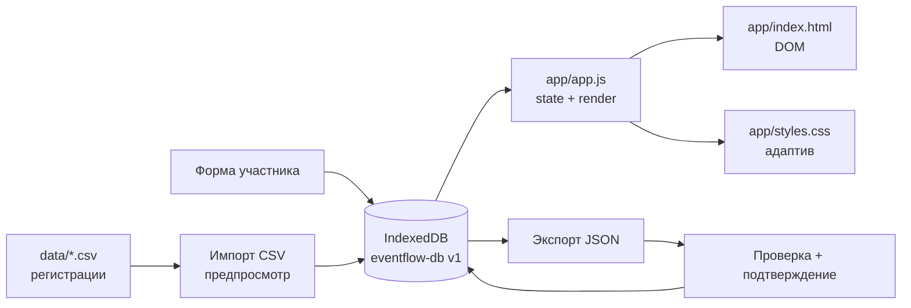
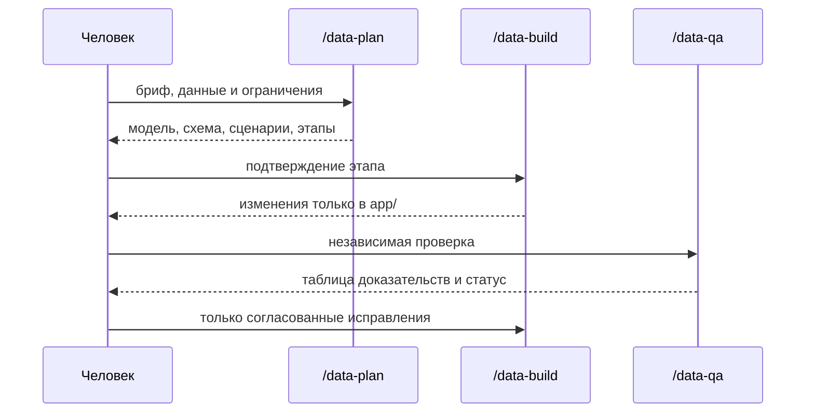

[](https://github.com/elstar883/eventflow-participant-manager/actions/workflows/tests.yml)
[](LICENSE)
[](app/index.html)
[](app/styles.css)
[](app/app.js)
[](app/db.js)
[](package.json)
[](AGENTS.md)

# EventFlow — менеджер участников события

Локальное приложение организатора, которое превращает разрозненные CSV-регистрации
в управляемый список участников: подтверждения, лист ожидания, отметки о приходе,
поиск, фильтры, архив и журнал действий.

Всё работает в одном браузере. Данные хранятся в IndexedDB, резервные копии — в
JSON, а приложение не делает ни одного сетевого запроса после загрузки.



---

## Содержание

- [Проблема](#проблема)
- [Что умеет приложение](#что-умеет-приложение)
- [Быстрый старт](#быстрый-старт)
- [Скриншоты](#скриншоты)
- [Как это устроено](#как-это-устроено)
- [Данные](#данные)
- [Модель IndexedDB](#модель-indexeddb)
- [Импорт CSV](#импорт-csv)
- [Резервные копии](#резервные-копии)
- [Workflow OpenCode](#workflow-opencode)
- [Проверки и CI](#проверки-и-ci)
- [Структура проекта](#структура-проекта)
- [Стек](#стек)
- [Доступность и адаптивность](#доступность-и-адаптивность)
- [Ограничения](#ограничения)
- [Дорожная карта](#дорожная-карта)
- [Лицензия](#лицензия)

---

## Проблема

Организатор образовательного события получает регистрации из формы, писем и
таблиц. Перед мероприятием нужно быстро понять:

- сколько людей подтвердили участие;
- кто находится в листе ожидания;
- кто уже пришёл;
- какие записи повторяются по email;
- что изменилось после звонков и ручных правок;
- как сохранить копию и перенести данные в другой браузер.

Когда сведения лежат в нескольких CSV, а изменения вносятся вручную, легко
потерять актуальное состояние. EventFlow собирает всё в одном локальном
интерфейсе и не отправляет данные в сеть.

**Решение:** один экран с показателями, таблицей участников, CRUD, поиском,
фильтрами, импортом CSV с предпросмотром, JSON-бэкапами и журналом действий.

## Что умеет приложение

### Показатели события

Четыре карточки пересчитываются после каждого изменения:

- всего активных участников;
- подтверждены;
- пришли;
- лист ожидания.

Архивные записи не входят в показатели и обычную таблицу.

### Участники и CRUD

Таблица показывает имя, компанию, email, билет, статус, дату регистрации и
отметку о приходе. Доступны действия:

- открыть карточку участника;
- изменить данные;
- отметить приход или снять отметку;
- отправить в архив.

Форма проверяет обязательные поля, формат email, уникальность email без учёта
регистра и правило «пришёл только подтверждённый участник». Ошибки показываются
рядом с полями.

### Поиск, фильтры и сортировка

- поиск по имени, email и компании;
- фильтр по статусу;
- фильтр по типу билета;
- сортировка по имени и дате регистрации в обе стороны;
- счётчик «Показано N из M» и количество архивных записей;
- сброс условий и понятное пустое состояние.

### Архив и отмена

Участник не удаляется безвозвратно: он уходит в архив и исчезает из активной
выдачи. В уведомлении есть кнопка «Отменить», которая возвращает запись в
течение 10 секунд.

### Импорт CSV с предпросмотром

До изменения базы приложение показывает:

- сколько строк найдено;
- сколько строк корректно;
- сколько строк содержит ошибки;
- номер строки и причину каждой ошибки;
- дубликаты по email внутри файла и в базе;
- кнопку импорта только корректных строк.

Ошибочные строки не попадают в IndexedDB. Корректные записываются одной
транзакцией, а результат попадает в журнал.

### Резервные копии JSON

Экспорт создаёт файл `schemaVersion: 1` с настройками события, участниками и
журналом. Восстановление сначала проверяет структуру и версию, затем показывает
предпросмотр с числами и требует отдельного подтверждения замены.

### Журнал действий

Последние 12 событий: добавление и изменение участника, check-in и check-out,
архивация и восстановление, импорт CSV, экспорт и восстановление копии.

### Локальность

- нет backend, облачной базы и API;
- нет фреймворков, сборщиков и runtime-зависимостей;
- нет внешних шрифтов, картинок и аналитики;
- данные не покидают браузер;
- перенос между браузерами — только через JSON-файл.

## Быстрый старт

Нужен современный браузер. Node.js и Python понадобятся только для проверок и
локального статического сервера.

```bash
git clone https://github.com/elstar883/eventflow-participant-manager.git
cd eventflow-participant-manager

make serve
# или:
python3 -m http.server 8080 --directory app
```

Откройте <http://127.0.0.1:8080>.

Приложение нужно запускать через HTTP-сервер: оно использует ES-модули и
IndexedDB, поэтому открытие `app/index.html` через `file://` не гарантируется.

Демонстрационные данные импортируются из `data/participants.csv`, ошибки — из
`data/participants-with-errors.csv` (после основного файла), а пример копии для
восстановления лежит в `docs/examples/backup-sample.json`.

### Проверка данных и кода

```bash
make check
# или:
node scripts/validate.mjs
node --check app/app.js
node --check app/db.js
node --check app/csv.js
node --check app/backup.js
```

Скрипт проверяет оба CSV, пример резервной копии, настройки события, схему
IndexedDB, обязательные элементы интерфейса, документацию и отсутствие сетевых
вызовов.

## Скриншоты

| Десктоп | Мобильная версия |
|---|---|
|  |  |

Полные страницы: [desktop 1440 px](docs/images/eventflow-desktop.png) ·
[mobile 390 px](docs/images/eventflow-mobile.png).

### Предпросмотр импорта с ошибками



Снимок сделан после импорта основного набора: 8 строк, 2 корректные, 6 с
ошибками и 2 дубликата. База не меняется до подтверждения.

## Как это устроено



1. `app.js` импортирует `db.js`, `csv.js` и `backup.js`.
2. `getSnapshot()` одной readonly-транзакцией читает участников, настройки и
   журнал.
3. `renderDashboard()` обновляет заголовок, показатели, таблицу и журнал.
4. Любое изменение проходит через функцию `db.js` и обновляет экран только после
   успешной транзакции.
5. Показатели и журнал всегда считаются из полного набора, а фильтры влияют
   только на таблицу.

Подробнее — в [docs/ARCHITECTURE.md](docs/ARCHITECTURE.md).

### Почему без фреймворка

Задача полностью клиентская: один экран, одна локальная база и несколько
файловых сценариев. Vanilla JavaScript позволяет показать работу с IndexedDB,
транзакциями, формами, доступностью и адаптивом без лишнего слоя. Нет
зависимостей — нет обновлений, уязвимостей и сюрпризов при запуске. Node.js
используется только для проверок и CI.

## Данные

Демонстрационные наборы синтетические: все email оканчиваются на
`@example.ru`, реальные люди и компании не используются.

### `data/participants.csv`

| Показатель | Значение |
|---|---:|
| Всего строк | 12 |
| Корректных | 12 |
| Ошибочных | 0 |
| Дубликатов | 0 |
| Подтверждены | 6 |
| Новые | 3 |
| Лист ожидания | 2 |
| Отменены | 1 |
| Пришли | 3 |
| VIP / бизнес / стандарт | 3 / 4 / 5 |

После импорта показатели приложения: **12 / 6 / 3 / 2**.

### `data/participants-with-errors.csv`

| Показатель | Значение |
|---|---:|
| Всего строк | 8 |
| Корректных | 2 |
| Ошибочных | 6 |
| Дубликатов | 2 |

Файл демонстрирует шесть разных ошибок: некорректный email, пустое имя,
совпадение с базой, недопустимый статус, check-in при `waitlist` и дубликат
внутри файла. Импортировать его нужно после основного набора.

### `docs/examples/backup-sample.json`

| Показатель | Значение |
|---|---:|
| Участники | 15 |
| Активные | 14 |
| В архиве | 1 |
| Действия | 4 |
| Подтверждены | 7 |
| Пришли | 3 |

Подробнее — в [docs/DATA-MODEL.md](docs/DATA-MODEL.md).

## Модель IndexedDB

База `eventflow-db`, версия `1`.

| Хранилище | Ключ | Индексы | Назначение |
|---|---|---|---|
| `participants` | `id` | `email` (unique), `status`, `registeredAt`, `archivedAt` | Участники |
| `settings` | `key` | — | Настройки события |
| `activity` | `id` | — | Журнал действий |

Участник содержит `id`, `name`, `email`, `company`, `ticket`, `status`,
`checkedIn`, `registeredAt`, `archivedAt` и `updatedAt`. Email уникален без
учёта регистра. `checkedIn: true` допустим только для статуса `confirmed`.

## Импорт CSV

Конвейер: **файл → разбор → проверка → предпросмотр → подтверждение → одна
транзакция**.

- Поддерживаются UTF-8 BOM, CRLF, запятая и точка с запятой, кавычки и переводы
  строк внутри кавычек.
- Обязательные колонки: `name`, `email`, `ticket`, `status`, `checked_in`,
  `registered_at`; `company` необязательна.
- `checked_in` принимает `true/false`, `1/0`, `yes/no`, `да/нет`.
- Ошибочные строки остаются в предпросмотре и не попадают в базу.
- При подтверждении email и поля проверяются повторно внутри транзакции.
- Результат импорта записывается в журнал.

## Резервные копии

Экспорт создаёт JSON:

```json
{
  "schemaVersion": 1,
  "exportedAt": "2026-10-31T11:24:15.819Z",
  "event": {
    "name": "Практикум «Продукты с ИИ»",
    "venue": "Учебный центр",
    "capacity": 120
  },
  "participants": [],
  "activity": []
}
```

Восстановление:

1. выбрать файл;
2. проверить структуру, версию, участников и журнал;
3. увидеть предпросмотр с числами;
4. подтвердить замену отдельным чекбоксом;
5. заменить все три хранилища одной транзакцией.

Неверный или несовместимый файл не меняет базу.

## Workflow OpenCode

Проект собран не «одним промптом», а воспроизводимым процессом с разделением
ролей:



- **`/data-plan`** — проектирует данные и сценарии, не меняя файлы.
- **`/data-build`** — реализует подтверждённый этап только внутри `app/`.
- **`/data-qa`** — проверяет приложение по критериям и ничего не исправляет.

Методика описана в
[`.opencode/skills/eventflow-participant-manager/SKILL.md`](.opencode/skills/eventflow-participant-manager/SKILL.md),
правила проекта — в [`AGENTS.md`](AGENTS.md).

## Проверки и CI

```bash
make check
```

`scripts/validate.mjs` проверяет:

- обязательные файлы и метаданные репозитория;
- совпадение `data/event-settings.json` со схемой `app/db.js`;
- оба CSV-набора и их статистику;
- демонстрационную резервную копию;
- обязательные элементы интерфейса;
- отсутствие внешних ресурсов, `fetch`, `XMLHttpRequest`, Storage API и
  динамических импортов;
- локальные ссылки на скриншоты;
- синтаксис всех модулей.

GitHub Actions прогоняет те же проверки на Node.js 18, 20 и 22 при push в
`main`/`develop` и на pull request.

Ручной сценарий — в [docs/QA-CHECKLIST.md](docs/QA-CHECKLIST.md).

## Структура проекта

```text
eventflow-participant-manager/
├── app/                              # статическое приложение
│   ├── index.html                    # разметка, таблица, диалоги
│   ├── styles.css                    # оформление, состояния, адаптив
│   ├── db.js                         # IndexedDB, CRUD, транзакции, журнал
│   ├── csv.js                        # разбор и проверка CSV
│   ├── backup.js                     # экспорт и проверка JSON
│   └── app.js                        # состояние, рендер, сценарии
├── data/
│   ├── event-settings.json           # событие, статусы, билеты (только чтение)
│   ├── participants.csv              # 12 корректных регистраций
│   └── participants-with-errors.csv  # 8 строк с ошибками и дубликатами
├── references/
│   ├── project-brief.md              # продуктовый бриф
│   ├── acceptance-checklist.md       # критерии готовности
│   └── visual-reference.png          # визуальный ориентир
├── docs/
│   ├── ARCHITECTURE.md               # архитектура и поток данных
│   ├── DATA-MODEL.md                 # модель, CSV и JSON
│   ├── QA-CHECKLIST.md               # ручная и автоматическая проверка
│   ├── examples/backup-sample.json   # пример резервной копии
│   └── images/                       # скриншоты desktop и mobile
├── .opencode/
│   ├── commands/                     # data-plan, data-build, data-qa
│   └── skills/
│       └── eventflow-participant-manager/
│           └── SKILL.md              # повторяемая методика
├── scripts/
│   └── validate.mjs                  # проверка данных и ограничений
├── .github/workflows/tests.yml       # CI
├── AGENTS.md                         # правила проекта
├── CONTRIBUTING.md                   # ветки, коммиты, PR-процесс
├── LICENSE                           # MIT
├── Makefile                          # make check / make serve
├── package.json                      # только скрипты, без зависимостей
├── opencode.json                     # разрешения OpenCode
└── README.md
```

## Стек

- **HTML5** — семантическая разметка, таблица, нативные `dialog`;
- **CSS3** — custom properties, Grid, Flexbox, медиазапросы,
  `prefers-reduced-motion`;
- **Vanilla JavaScript** — ES-модули, состояние, DOM API, `Intl.Collator`;
- **IndexedDB** — три хранилища, индексы, транзакции;
- **File API** — импорт CSV и JSON без загрузки на сервер;
- **Blob API** — экспорт резервной копии;
- **Node.js 18+** — только для `scripts/validate.mjs` и CI;
- **GitHub Actions** — матрица Node.js 18/20/22;
- **OpenCode** — команды и Skill.

Без фреймворков, сборщиков, пакетов и runtime-зависимостей.

## Доступность и адаптивность

- семантические ориентиры `header`, `main`, `section`, `aside`, `footer`;
- skip-link «Перейти к содержимому»;
- `aria-live` для таблицы, журнала и уведомлений;
- подписи полей и `aria-describedby` для ошибок;
- видимый фокус и полная работа с клавиатуры;
- нативные диалоги с заголовками;
- `prefers-reduced-motion` отключает анимации;
- таблица превращается в карточки на узком экране;
- проверено на 1440, 768 и 390 px без горизонтальной прокрутки.

## Ограничения

- данные живут в IndexedDB одного браузера;
- нет аккаунтов, ролей и совместной работы;
- нет облачной синхронизации и автоматического резервного копирования;
- фильтры не сохраняются в URL и не переживают перезагрузку;
- архив отдельного экрана не имеет: восстановление — через отмену или JSON;
- приложение не отправляет данные и не собирает аналитику;
- демонстрационные данные синтетические и не являются реальными регистрациями.

## Дорожная карта

- [ ] отдельный экран архива;
- [ ] сохранение фильтров в URL hash;
- [ ] печатная версия списка участников;
- [ ] импорт нескольких CSV за один сеанс;
- [ ] покрытие сценариев тестами Playwright;
- [ ] GitHub Pages для живого демо;
- [ ] английская версия интерфейса.

## Лицензия

Проект распространяется по лицензии [MIT](LICENSE).

## Автор

**Elsa** — [@elstar883](https://github.com/elstar883)

Проект собран как портфолио-кейс: от анализа требований и модели данных до
статического приложения на IndexedDB, автоматических проверок, CI и независимой
QA-проверки.
