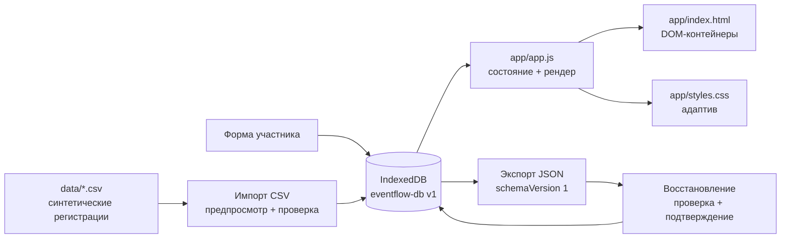
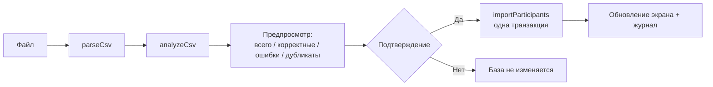

# Архитектура

## 1. Общая картина

EventFlow — статическое приложение без backend, сборки и внешних зависимостей.
Браузер загружает HTML, CSS и четыре ES-модуля, открывает IndexedDB и строит
интерфейс организатора целиком на клиенте.



Ключевое ограничение: после загрузки приложение не делает сетевых запросов.
Все данные остаются в IndexedDB браузера, а перенос между браузерами возможен
только через JSON-файл.

## 2. Файлы и ответственность

| Файл | Ответственность |
|---|---|
| `app/index.html` | Семантическая разметка, показатели, таблица, диалоги, `aria`-связи |
| `app/styles.css` | Токены, компоненты, состояния, адаптив, `prefers-reduced-motion` |
| `app/db.js` | Схема IndexedDB, настройки события, CRUD, транзакции, журнал |
| `app/csv.js` | Разбор CSV, проверка строк, поиск дубликатов, статистика импорта |
| `app/backup.js` | Создание и полная проверка JSON-резервной копии |
| `app/app.js` | Состояние интерфейса, рендеринг, диалоги, сценарии пользователя |
| `data/*.csv` | Синтетические наборы для демонстрации импорта; только чтение |
| `data/event-settings.json` | Статусы, билеты и настройки события; только чтение |
| `scripts/validate.mjs` | Автоматическая проверка данных, документации и ограничений |
| `docs/examples/backup-sample.json` | Пример валидной копии для демонстрации восстановления |

## 3. Запуск приложения

1. Статический сервер отдаёт `app/index.html`.
2. Браузер загружает `styles.css` и `app.js` как ES-модуль.
3. `app.js` импортирует `db.js`, `csv.js` и `backup.js`.
4. `init()` заполняет фильтры и формы, навешивает обработчики и вызывает
   `loadDashboard()`.
5. `getSnapshot()` одной readonly-транзакцией читает `participants`, `settings`
   и `activity`.
6. `renderDashboard()` обновляет заголовок, показатели, таблицу и журнал.
7. При первом запуске `ensureSettings()` создаёт запись `event` с настройками
   по умолчанию, синхронизированными с `data/event-settings.json`.

Приложение нужно открывать через локальный HTTP-сервер: ES-модули и IndexedDB
рассчитаны на нормальный origin, а не на `file://`.

## 4. Состояние интерфейса

```js
{
  event: null,
  participants: [],
  activity: [],
  loading: true,
  error: null,
  filters: {
    query: "",
    status: "",
    ticket: "",
    sort: "registered-desc"
  }
}
```

Дополнительно есть небольшие объекты состояния для формы, импорта, экспорта и
восстановления. Состояние живёт только в памяти страницы: оно не пишется в URL,
`localStorage` или cookies. После перезагрузки данные читаются из IndexedDB, а
фильтры сбрасываются.

## 5. IndexedDB и транзакции

База: `eventflow-db`, версия схемы `1`.

| Хранилище | Ключ | Индексы | Назначение |
|---|---|---|---|
| `participants` | `id` | `email` (unique), `status`, `registeredAt`, `archivedAt` | Участники |
| `settings` | `key` | — | Настройки события, запись `event` |
| `activity` | `id` | — | Журнал действий |

Операции, которые меняют несколько записей, выполняются одной транзакцией:

- сохранение участника + запись в журнал;
- архивация/восстановление + запись в журнал;
- импорт всех корректных строк + одна запись об импорте;
- экспорт: отдельная запись в журнал;
- восстановление: очистка и запись `participants`, `settings`, `activity`
  одной транзакцией.

`performTransaction()` централизует обработку `oncomplete`, `onerror` и
`onabort`. Если запись не удалась, транзакция отменяется целиком, а интерфейс
показывает понятную ошибку.

## 6. CRUD и бизнес-правила

- `saveParticipant()` создаёт запись с UUID, `registeredAt = now`,
  `archivedAt = null` или обновляет существующую.
- Email нормализуется (trim + lower case) и проверяется на уникальность до
  записи; уникальный индекс в IndexedDB остаётся второй линией защиты.
- `validateParticipantDraft()` проверяет имя, email, компанию, статус, билет и
  правило `checkedIn → status === "confirmed"`.
- `archiveParticipant()` выставляет `archivedAt`; запись остаётся в базе, но
  исчезает из показателей и обычной таблицы.
- `restoreParticipant()` возвращает `archivedAt = null`.
- `setParticipantCheckIn()` запрещает отметку для неподтверждённого участника.
- Ошибки формы показываются рядом с полями; диалог не закрывается, пока данные
  не исправлены.

## 7. Конвейер CSV



`parseCsv()` поддерживает UTF-8 BOM, CRLF, запятую и точку с запятой, кавычки и
переводы строк внутри кавычек. Он проверяет обязательные заголовки:
`name`, `email`, `ticket`, `status`, `checked_in`, `registered_at`;
`company` необязательна.

`analyzeCsv()` не пишет в базу. Для каждой строки он проверяет:

- непустое имя и длину;
- корректность email и уникальность без учёта регистра;
- длину компании;
- допустимый билет и статус;
- `checked_in` как `true/false` (поддерживаются `1/0`, `yes/no`, `да/нет`);
- ISO-дату регистрации;
- `checked_in = true` только для `confirmed`;
- дубликаты внутри файла и совпадения с базой.

Ошибочные строки не попадают в IndexedDB. При подтверждении
`importParticipants()` повторно проверяет email и поля внутри транзакции: если
данные изменились в другой вкладке, строка пропускается, а не ломает импорт.

## 8. Экспорт и восстановление

`createBackupDocument()` собирает объект:

```json
{
  "schemaVersion": 1,
  "exportedAt": "2026-10-31T11:24:15.819Z",
  "event": { "name": "…", "venue": "…", "capacity": 120 },
  "participants": [],
  "activity": []
}
```

`validateBackupDocument()` до любой записи проверяет:

- что это объект и в нём есть поддерживаемый `schemaVersion`;
- корректность `exportedAt` и настроек события;
- массивы `participants` и `activity`;
- уникальность `id` и email;
- допустимые статусы, билеты, даты и правило check-in;
- структуру записей журнала.

Восстановление двухшаговое: сначала предпросмотр с числами, затем отдельный
экран подтверждения с чекбоксом. Только после этого `restoreBackup()` одной
транзакцией заменяет все три хранилища.

## 9. Журнал действий

`activity` хранит тип, сообщение, `participantId`, время и дополнительные
метаданные. Типы: `participant_added`, `participant_updated`, `check_in`,
`check_out`, `archived`, `restored`, `imported`, `backup_exported`,
`backup_restored`.

`getSnapshot()` читает весь журнал, интерфейс сортирует его по времени и
показывает 12 последних записей. Бейдж показывает общее количество действий.

## 10. Поиск, фильтры и сортировка

- поиск нормализует регистр через `toLocaleLowerCase('ru-RU')` и ищет по имени,
  email и компании;
- фильтры по статусу и типу билета применяются к активным записям;
- сортировка: имя по возрастанию/убыванию, дата регистрации по
  возрастанию/убыванию; для имени используется `Intl.Collator('ru')`;
- показатели и журнал всегда считаются из полного набора, а не из отфильтрованной
  выдачи;
- пустой результат объясняет, как сбросить условия.

## 11. Доступность и адаптивность

- семантические `header`, `main`, `section`, `aside`, `table`, `dialog`;
- skip-link «Перейти к содержимому»;
- `aria-live` для таблицы, журнала и уведомлений;
- подписи полей, `aria-describedby` для ошибок и подсказок;
- видимый фокус и полная работа с клавиатуры;
- `prefers-reduced-motion` отключает анимации;
- на узком экране таблица превращается в карточки с подписями;
- проверено на 1440, 768 и 390 px без горизонтальной прокрутки.

## 12. Сеть и безопасность

- нет `fetch`, `XMLHttpRequest`, WebSocket, `sendBeacon` и динамических импортов;
- нет внешних скриптов, шрифтов, картинок и CDN;
- нет аналитики, авторизации и облачной синхронизации;
- нет `localStorage` и `sessionStorage`;
- все демонстрационные email оканчиваются на `@example.ru`;
- опасные действия требуют подтверждения или возможности отмены.

Эти ограничения проверяет `scripts/validate.mjs` и CI.

## 13. Точки расширения

Приложение остаётся статическим, поэтому расширения должны сохранять контракт:

- печатная версия списка участников;
- сохранение фильтров в URL hash;
- отдельный экран архива;
- импорт нескольких CSV за один сеанс;
- тесты рендера в Playwright;
- GitHub Pages для живого демо.

Любое расширение не должно добавлять внешние библиотеки и сетевые вызовы без
пересмотра ограничений проекта.
